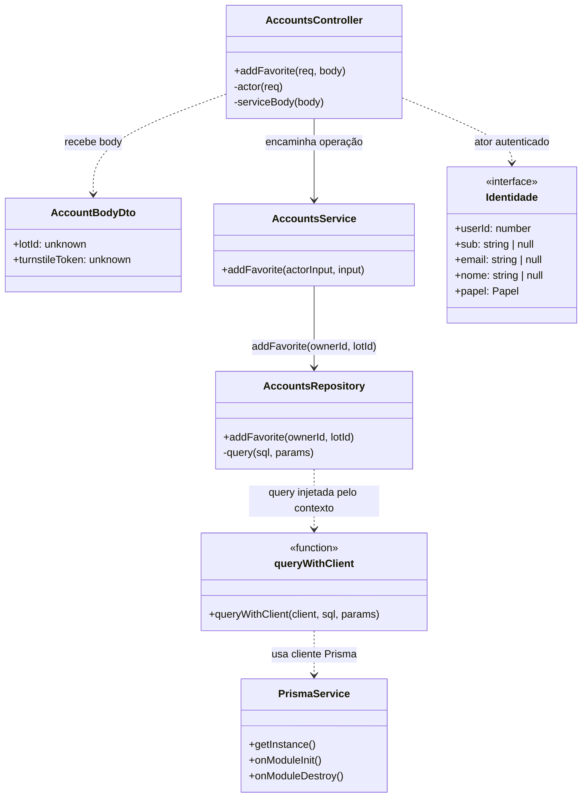

# Arquitetura C4 — código: adicionar lote aos favoritos

Recorte do fluxo `POST /api/favorites`, não um inventário de todas as classes do sistema. A identidade autenticada fornece o dono; a consulta de gravação é restrita ao `ownerId` e ao lote.

**Fluxo:** 1. `AccountsController.addFavorite` recebe o DTO e obtém o ator autenticado. 2. O controller remove `turnstileToken` do corpo encaminhado. 3. `AccountsService.addFavorite` exige ator, valida que o corpo contenha somente `lotId` e valida o ID. 4. O serviço chama `AccountsRepository.addFavorite(actor.userId, lotId)`. 5. O repositório insere com `ON CONFLICT (owner_id, lot_id) DO NOTHING`, mantendo a escrita vinculada ao dono.

**Símbolos no código:**
- [`AccountsController` e DTO](../src/application/controllers/accounts/accounts.controller.ts) · [`AccountBodyDto`](../src/application/controllers/accounts/accounts.dto.ts)
- [`AccountsService`](../src/application/services/accounts/accounts.service.ts) · [`AccountsRepository`](../src/infra/database/repositories/accounts.repository.ts)
- [`Identidade`](../src/domain/identity/identidade.ts) · [`queryWithClient`](../src/infra/database/query.ts) · [`PrismaService`](../src/infra/database/prisma.service.ts)
